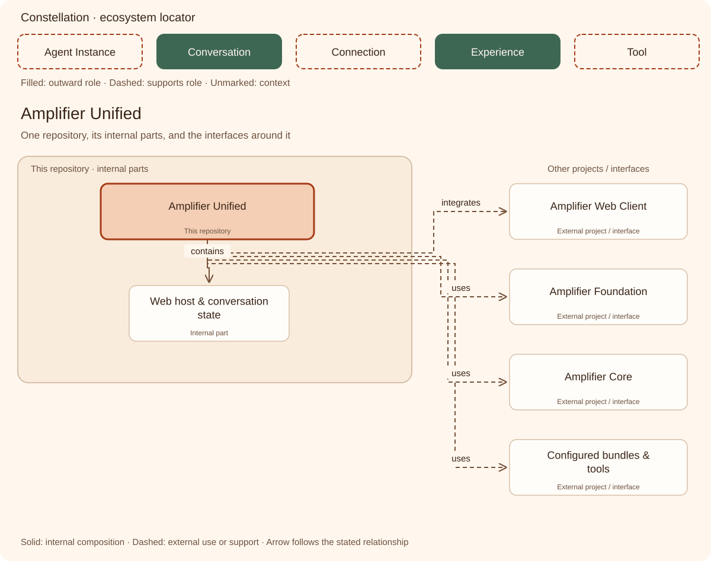

# Amplifier Unified

Amplifier Unified is a local workspace for working with AI. Chat or talk with an
assistant, give it tasks, and follow its work across conversations, tools, and
shared visual surfaces. It uses your configured Amplifier bundles and model accounts.

Explore the [Amplifier Unified website](https://unified.amplifier.ms/) for examples and getting started.

## Install

Choose your computer: [macOS or Linux](#macos-and-linux), or
[Windows 11 (preview)](#windows-11-preview).

### macOS and Linux

The installer supports **macOS and Linux**, including **Windows through WSL with
systemd**.

You need Git, curl, and CA certificates. On Ubuntu or Debian, install them with:

```sh
sudo apt-get update && sudo apt-get install -y curl git ca-certificates
```

On macOS, run `xcode-select --install` if Git is not already available. Then run
the installer as your normal user, without sudo:

```sh
curl -fsSL https://raw.githubusercontent.com/microsoft/amplifier-unified/main/scripts/install.sh | bash
```

It finds or installs uv and Python, installs the latest stable release, starts
Amplifier Unified as a per-user service, and opens your browser. Existing Amplifier
configuration, accounts, and history are preserved. For manual installation, see
the [platform and recovery instructions](docs/DEPLOYMENT.md#manual-installation).

### Windows 11 (preview)

This is a preview. The setup file is not signed yet, so your browser asks you to
confirm the download. You do not need WSL, Python, Git or a terminal.

1. Download the setup file:
   [AmplifierUnifiedSetup-windows-x64.exe](https://github.com/microsoft/amplifier-unified/releases/latest/download/AmplifierUnifiedSetup-windows-x64.exe).
2. Microsoft Edge holds the download. In the Downloads list, point at the file
   and select **More actions (…)**, then **Keep**. In the message that follows,
   select the arrow next to **Delete**, then **Keep anyway**.
3. Open the file with a double-click. Do not use "Run as administrator". Select
   **OK** to install. Setup takes about 3 minutes.
4. Amplifier starts and opens in your browser. The first start can take a few
   minutes. Windows asks one question: whether to install a certificate named
   "Amplifier Unified (this PC only)". Select **Yes**. Amplifier uses this
   certificate only for the connection between your browser and Amplifier on
   this PC.
5. Connect an AI account in the app.

To open Amplifier later, use the Start menu: **Amplifier Unified**.

Limits of this preview:

- **PC:** Windows 11 with an Intel or AMD processor. ARM processors are not
  supported yet.
- **Account:** Amplifier installs for your own Windows account only. It does not
  need administrator rights.
- **Folder:** everything is in `%LOCALAPPDATA%\Amplifier`.
- **Uninstall:** open **Settings > Apps > Installed apps**, find
  **Amplifier Unified (unsigned preview)**, select **More options (…)**, then
  **Uninstall**. In this version, uninstall stops Amplifier and removes it from
  the Start menu and the Apps list. It leaves the folder with your chats,
  settings and accounts, and the program files.

The [native Windows design and status](docs/design/native-windows-installation.md)
records what is tested.

## Start a conversation

1. Sign in to Amplifier Unified in the browser and connect a model account if needed.
2. Choose a workspace and start a chat. You can finish setup with an assistant
   or use **Settings**.
3. Describe the outcome you want. Review progress and results in the conversation.

The first message can take a few minutes while Amplifier Unified prepares its runtime.
On macOS and Linux, you can reopen the workspace at
[http://127.0.0.1:8941](http://127.0.0.1:8941). On Windows 11, open
**Amplifier Unified** from the Start menu.

Use **Enter** to send and **Shift+Enter** for a new line. You can format messages
with Markdown and attach files or images. In a code block, Enter inserts a line;
use the Send button to submit the message.

## Use Amplifier Unified your way

- **Settings:** choose models, bundles, and capabilities. [Settings guide](docs/SETTINGS.md).
- **Updates:** open **Settings → Updates** to check for a release or configure automatic checks. [Update guide](docs/UPDATES.md).
- **Another device:** configure a trusted HTTPS address for LAN or Tailscale access. [Deployment guide](docs/DEPLOYMENT.md).
- **An app window:** use your browser's install option, Safari's **Add to Dock**, or **Add to Home Screen**. Amplifier Unified must remain running at the same address.
- **Recovery:** use the [reset guide](docs/RESET.md) to repair an installation while preserving your data.

## Develop Amplifier Unified

See [development setup and contribution guidance](CONTRIBUTING.md) to work from
source. Published packages include the web client; only frontend development
requires Node.js and npm. Browser client source is maintained in
[amplifier-client-web](https://github.com/microsoft/amplifier-client-web).

For integrations, see [Amplifier Unified as an ACP backend](docs/architecture/unified-acp-backend.md)
and the [architecture guide](docs/architecture/README.md).


<!-- ecosystem-map:start -->
## Where this fits

A complete AI workspace with its own web host, selected browser client, and configurable Amplifier execution.

Roles: Experience, Conversation. Supports: Agent Instance, Tool, Connection.



[Product website](https://unified.amplifier.ms/) · [Ecosystem map](https://microsoft.github.io/amplifier-constellation/projects/amplifier-unified/) · [Open the map](docs/ecosystem-map.svg) · [Map guide](https://github.com/microsoft/amplifier-constellation/blob/main/docs/ecosystem-maps.md)

<details>
<summary>The five shared building blocks</summary>

[](https://microsoft.github.io/amplifier-constellation/)

</details>

<!-- ecosystem-map:end -->

## Contributing

> [!NOTE]
> This project is not currently accepting external contributions, but we're actively working toward opening this up. We value community input and look forward to collaborating in the future. For now, feel free to fork and experiment!

Most contributions require you to agree to a
Contributor License Agreement (CLA) declaring that you have the right to, and actually do, grant us
the rights to use your contribution. For details, visit [Contributor License Agreements](https://cla.opensource.microsoft.com).

When you submit a pull request, a CLA bot will automatically determine whether you need to provide
a CLA and decorate the PR appropriately (e.g., status check, comment). Simply follow the instructions
provided by the bot. You will only need to do this once across all repos using our CLA.

This project has adopted the [Microsoft Open Source Code of Conduct](https://opensource.microsoft.com/codeofconduct/).
For more information see the [Code of Conduct FAQ](https://opensource.microsoft.com/codeofconduct/faq/) or
contact [opencode@microsoft.com](mailto:opencode@microsoft.com) with any additional questions or comments.

## Trademarks

This project may contain trademarks or logos for projects, products, or services. Authorized use of Microsoft
trademarks or logos is subject to and must follow
[Microsoft's Trademark & Brand Guidelines](https://www.microsoft.com/legal/intellectualproperty/trademarks/usage/general).
Use of Microsoft trademarks or logos in modified versions of this project must not cause confusion or imply Microsoft sponsorship.
Any use of third-party trademarks or logos are subject to those third-party's policies.
