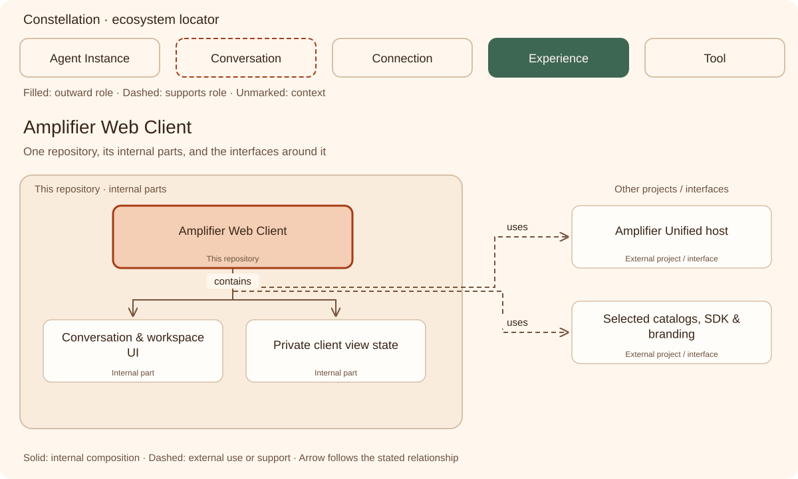

# Amplifier Web Client

The browser interface for [Amplifier Unified](https://github.com/microsoft/amplifier-unified):
conversations, workspaces, tool activity, and interactive work surfaces. The client
connects to a Unified host over HTTP, server-sent events, and WebSockets; the host
runs agents and stores conversation history.

**To use Amplifier, install [Unified](https://github.com/microsoft/amplifier-unified#readme).**
This repository is for developers working on its web client. Source changes here
do not automatically update a Unified installation.

## Get started

Use Node.js 22. Clone this repository, then install dependencies and prepare the
shared catalogs, SDK, and branding selected by `build-inputs.lock.json`:

```sh
git clone https://github.com/microsoft/amplifier-client-web.git
cd amplifier-client-web
npm ci
npm run prepare:inputs
```

Input preparation fetches the pinned public files and verifies their hashes.
For offline work, use `npm run prepare:inputs -- /path/to/canonical-export` with
the exact locked export.

Run a compatible [Unified development host](https://github.com/microsoft/amplifier-unified/blob/main/CONTRIBUTING.md)
on port 8765, then start the client:

```sh
npm run dev
```

Open the local address printed by Vite. API and WebSocket requests are proxied to
the development host. This client does not install or start the agent backend.

## Check and build

```sh
npm test
npm run build
npm run test:artifact-assets
```

The build writes `dist/`. See [package.json](package.json) for focused checks and
[AGENTS.md](AGENTS.md) for source, test, and packaging guidance.

## Temporary dual-repository maintenance

This repository owns the browser source. Changes intended for Unified must also
reach its selected `components/web-client/` copy, through the
[documented refresh workflow](https://github.com/microsoft/amplifier-unified/blob/main/components/README.md#refresh-and-retire-the-copy)
or a named integration handoff. Author changes here first; do not hand-edit that
copy. This requirement remains until an approved delivery transition updates both
repositories' guidance.

For interface and design work, use the pinned
[client vision](https://github.com/microsoft/amplifier-unified/blob/816c7a67dbafc20bfb28723dd317c71d3bd2bb28/docs/clients/VISION.md) and
[client development contract](https://github.com/microsoft/amplifier-unified/blob/816c7a67dbafc20bfb28723dd317c71d3bd2bb28/contracts/client-development.v1.md).

See [support](SUPPORT.md), [security reporting](SECURITY.md), and the [MIT license](LICENSE).


<!-- ecosystem-map:start -->
## Where this fits

The selected browser frontend for the current Amplifier Unified application.

Roles: Experience. Supports: Conversation.



[Product page](https://microsoft.github.io/amplifier-constellation/projects/amplifier-client-web/) · [Open the map](docs/ecosystem-map.svg) · [Map guide](https://github.com/microsoft/amplifier-constellation/blob/main/docs/ecosystem-maps.md)

<details>
<summary>The five shared building blocks</summary>

[](https://microsoft.github.io/amplifier-constellation/)

</details>

<!-- ecosystem-map:end -->

## Contributing

Most contributions require you to agree to a
Contributor License Agreement (CLA) declaring that you have the right to, and actually do, grant us
the rights to use your contribution. For details, visit [Contributor License Agreements](https://cla.opensource.microsoft.com).

When you submit a pull request, a CLA bot will automatically determine whether you need to provide
a CLA and decorate the PR appropriately (e.g., status check, comment). Simply follow the instructions
provided by the bot. You will only need to do this once across all repos using our CLA.

This project has adopted the [Microsoft Open Source Code of Conduct](https://opensource.microsoft.com/codeofconduct/).
For more information see the [Code of Conduct FAQ](https://opensource.microsoft.com/codeofconduct/faq/) or
contact [opencode@microsoft.com](mailto:opencode@microsoft.com) with any additional questions or comments.

## Trademarks

This project may contain trademarks or logos for projects, products, or services. Authorized use of Microsoft
trademarks or logos is subject to and must follow
[Microsoft's Trademark & Brand Guidelines](https://www.microsoft.com/legal/intellectualproperty/trademarks/usage/general).
Use of Microsoft trademarks or logos in modified versions of this project must not cause confusion or imply Microsoft sponsorship.
Any use of third-party trademarks or logos are subject to those third-party's policies.
