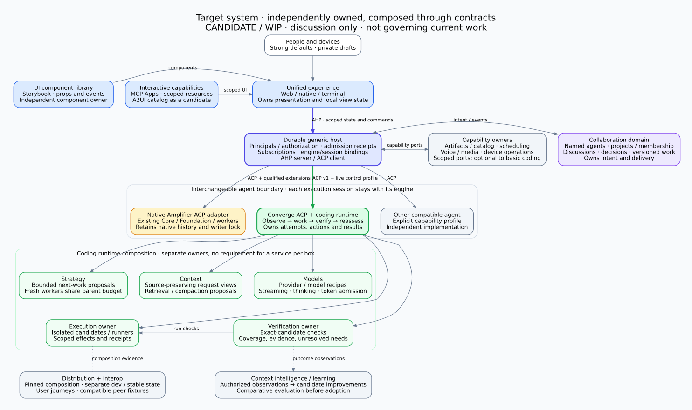
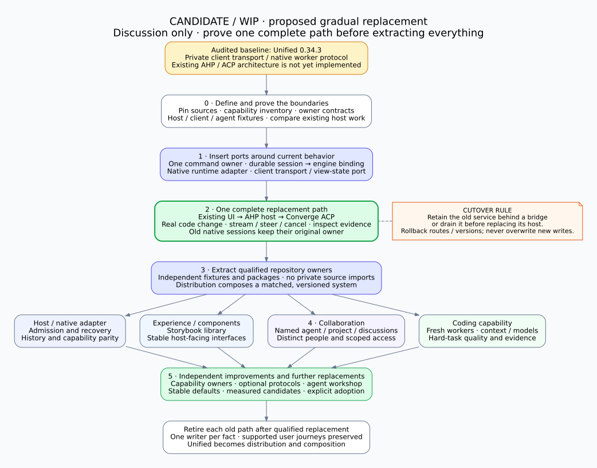

# Candidate modular architecture and transition

> **Candidate / WIP — discussion only.** This folder is an unadopted proposal for
> peer collaboration. Its contents do not govern current implementation, amend
> adopted contracts, authorize migration, or establish release requirements.

Packaged October 29, 2026. Architecture and source audit prepared October 28.

The proposal preserves the useful Unified experience while making its components
independently replaceable. Establish ownership and contracts, prove a complete
replacement path, extract qualified components into separate repositories, then
improve those owners in parallel. Avoid making every optional interface a
prerequisite for the first useful substitution.

## Relationship to current direction

The existing [architecture](../../architecture/README.md),
[architecture vision](../../architecture/VISION.md), [repository guidance](../../../AGENTS.md)
and adopted [host](../../../contracts/host-protocol.v1.md),
[agent](../../../contracts/agent-protocol.v1.md) and
[component](../../../contracts/component-boundaries.v1.md) contracts remain the
references for current work. This candidate does not supersede them. Keeping or
merging this folder does not by itself adopt any of its proposals.

The candidate builds on the existing AHP-host/ACP-agent direction. Its proposed
additions include a Converge coding backend, persistent agent identities above
engine sessions, a collaboration domain with one owner of intent, and a staged
replacement plan. Repository names are proposals unless explicitly marked existing.

Any adopted change should be recorded separately in the relevant governing vision
and contracts, with the accepted scope, owner and qualification evidence. Do not
treat proposed phases, acceptance cases or reviewer questions as assigned work.

## Read the proposal

| Document | Purpose |
| --- | --- |
| [Candidate vision](VISION.md) | Product outcomes and design priorities, without personal discussion history |
| [Target architecture](target.md) | Responsibilities, state authority, lifecycle, protocols and deployment |
| [Boundary draft](boundaries.md) | Proposed promises and proof obligations; not adopted contracts |
| [Transition proposal](transition.md) | Current-code mapping, phases, rollback and possible parallel lanes |
| [Harness profile](harness-profile.md) | Context for the proposed alternate agent, including capability limits |
| [Unified source audit](evidence/unified-source-audit.md) | Revision-bound implementation evidence supporting the transition |
| [Source manifest](source-baseline.json) | Exact audited source revisions and official protocol references |
| [Package validation](validation.json) | Packaging, link, diagram and privacy-review results |

Editable Graphviz sources are beside the rendered diagrams. All local links stay
within this repository. Code references in the transition are pinned to the
audited revision; existing governing documents are linked in their current location.
The Converge implementation is not bundled or installed by this package.

## Review focus

- Does the ownership map leave exactly one authority for each fact, especially
  intent, execution, evidence, delivery and native session ownership?
- Is an execution-session routing boundary the smallest useful first substitution?
  Which existing host or adapter implementation should own it?
- Does persistent collaboration belong in the proposed separate domain, and what
  identity/access/conflict promises must be explicit before multi-human use?
- Which native capabilities must accompany the first usable replacement, and
  which can remain on their existing engine during transition?
- Which repository extractions enable genuinely independent work, and which
  should remain smaller package boundaries?
- Are the proposed user journeys sufficient to detect lost work, lost context,
  duplicate effects, incorrect acceptance and unsafe rollback?

The first proving path is a new coding session in the existing experience, routed
through the proposed public boundaries, with streaming, steering and independently
checked results. Existing native sessions retain their native owner. Current host
shutdown stops native workers, so a later live cutover requires retained ownership
behind a bridge or a tested drain; durable history alone is insufficient.

## Evidence and privacy scope

Implementation observations refer to Unified commit
[`924acff`](https://github.com/microsoft/amplifier-unified/tree/924acff405de367ac408f7e9b2b9cc7ea4baa47a)
(0.34.3), audited October 28. Packaging against a newer branch does not turn this
into a new runtime or deployment qualification. Proposed smoke journeys are not
tests claimed to have run. Historical harness results are described with their
original limits.

The shared package excludes meeting/chat transcripts, personal attribution,
usernames, personal contact details, local filesystem locations, host/network
identifiers and credential values. Technical descriptions of authentication and
token handling remain because they affect the design; no live credential or
service endpoint is included. Source commit IDs identify code, not people.
