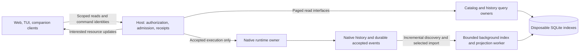

# Main application: bounded data and responsive clients

**Status: implementation plan approved, October 14, 2026.** The user approved
proceeding with this sequence after reviewing draft PR #671. This applies the
ratified [vision](../docs/architecture/VISION.md), [working-set contract](../contracts/working-set.v1.md),
[client-state contract](../contracts/client-state.v1.md), and [component boundaries](../contracts/component-boundaries.v1.md)
to the current main application. It does not ratify new wire semantics, declare
performance targets achieved, or authorize replacing the running architecture.
Implementation baseline: `7a079422f103d9bb4e6fd5cceea7dcf09b03b9a8`;
live measurement baseline: v0.20.141, `a2ef2dca74cb2b3297e731462038736d21bb6b3f`.

The outcome is a host whose ordinary work depends on the few conversations people
use, the pages they request, and currently executing work. A large dormant library
must remain searchable without becoming resident application state. Preserve
native history, execution ownership, recoverable commands, and existing clients
through an incremental migration. AHP/ACP remains the separately qualified
[future protocol track](../docs/architecture/delivery-plan.md).

## Evidence and the first decision

| Finding | What it supports; what it does not establish |
| --- | --- |
| A 15-second live profile attributed about 8.9 seconds of main-thread samples to shell inspection/snapshots, including about 8.2 seconds in chat projections. | Repeated projections and SQL aggregates are immediate targets. It does not mean every historical transcript was parsed. |
| A synthetic admission request spent 1,461 ms before Python handler entry and 31 ms inside it, overlapping two shell requests of roughly 720 ms each. | Projection work can starve unrelated requests. This does not retrospectively prove the cause of every production or CI timeout. |
| A narrow, unreleased query patch reduced a seven-query 27k-record workload from 6.97 to 4.88 seconds, with identical results and 82 passing tests. | Removing duplicate counts and broad pin queries helps; hidden queries and expensive remaining aggregates still require structural work. These are not HTTP or live-user timings. |
| One live cold chat switch took about 8.6 seconds to first messages/Work and 17.7 seconds to the expected Work groups. | Publication of .141 did not solve the user experience. Large selected histories must be measured separately from catalog cardinality. |

Retained investigation evidence is recorded in the workspace manifest and
`output/work-activity-20261013/bounded-directory/release141/`: `live141-profile-summary.json`,
`live-adoption.json`, `shell-chat-queries/summary.json`, and
`admission-tail/diagnostic-followup/qualification.json`. These are operator evidence
paths, not files shipped with this repository. Each implementation PR must retain
its own reproducible fixtures and exact-source receipts; these observations alone
are not a release qualification.

Start by bounding work and shortening the control-plane critical path. Keep
Python initially. A faster language cannot remove unnecessary queries, unsafe
invalidation, or ownership ambiguity. Profile an isolated component before
considering a Rust implementation behind the same interface.

## Implementation progress, October 14

Release .143 includes the bounded requested navigation pages and removal of
duplicate ordinary-state projections; .142 was not published. Live .143 measurement reduced shell response size and
cost, but did not stop repeated reads: its broad `shellDataKey` changed with no
selection, status, model, Canvas or shell-token change. Selected Work reconstruction
also remains slow on large histories; these are separate outstanding costs.

The .144 change, merged in PR #680 with publication pending, replaces that refresh fan-in with the
[existing-stream shell resource contract](../docs/browser-state-transport.md#shell-bootstrap-and-active-resources).
Descriptors load once per host/composition generation. Explicit demand selects
pages, canonical committed changes invalidate their semantic dependencies, and
immutable resource revisions travel through the existing state-delta baseline.
Independent component snapshots retain their SDK contract. Bounded diagnostics
record reasons and timings without conversation content. Qualification and live
adoption are separate evidence; this entry does not claim the candidate is
published or that selected-history performance has been solved.

A separate selected-history follow-up preserves exact-object size charges during
one retention pass, avoiding repeated traversal when an earlier index evicts a
later index still held by that read. Its two-file implementation passed 139
focused tests. A paired synthetic three-log probe reduced stable size traversals
from three to one while preserving output and remeasuring newly restored objects.
The follow-up is not published, and this mechanism proof does not establish a live
latency improvement. Live .144 measurements determine the next history priority.

## Ownership and data flow

The boxes are responsibilities, not a requirement for one network service per box.
Keep the existing transport while introducing internal interfaces and explicit
resource demand. The bundled client and server adopt each change together;
capability negotiation is only for independently versioned contracts that need
it. Never label the existing REST/SSE transport AHP.

| Owner | Authority | Rebuildable or disposable state |
| --- | --- | --- |
| Native runtime/storage | Native session identity, transcript, retained events, safe resume and exclusive writer ownership | Runtime caches, independently budgeted from readable history |
| Host control plane | Authorization, admission, command receipts, accepted work and durable coordination records | Small active registry and dependency subscriptions |
| Catalog | Derived public/native associations, workspace availability, search/order/filter and discovery coverage | Indexed metadata, source-absence observations and query caches; never resume authority |
| History projection | Derived message windows, Work summaries/details, source coverage and revision-bound cursors | Per-session read models and bounded body cache; never a second canonical transcript |
| Client | Private drafts, selection, scroll, expansion and uncommitted edits | Bounded fetched resources; clearing a read cache must preserve drafts and pending command identities |

Canonical host coordination records remain authoritative even when queryable
through derived indexes. Catalog results are discovery, not permission or execution
grants; the host revalidates authority at admission. One owner defines identity and
association rules for all readers. No client reads another component's tables or
imports its private implementation.

Durable user deletion, hiding, archive and identity-suppression records belong to
their authoritative host owner. They are not disposable source-absence markers.
Every index rebuild reapplies those records and must not resurrect deliberately
removed identities. Asynchronous reads also recheck current read authority before
returning or publishing content: bind jobs, deduplication, cursors and results to
principal/scope, and reject results after access revocation even if source bytes
and generation are unchanged.

## Catalog and workspace design

Build on the existing durable directory instead of adding a competing catalog.
Main already has scalar metadata indexes, paged directory queries, exact-ID probes
and demand-driven transcript loading. Preserve that progress; this plan addresses
remaining aggregate work, eager projection construction and expensive selected
history reconstruction. Backgrounding a full restore into resident application
state would still violate the intended bound.
Expose indexed, paged root-chat and workspace queries with explicit filters,
ordering, authorization scope, revision and completeness. Apply membership and
authorization before pagination. Use stable ordering with an identity tie-breaker;
bind cursors to the query and snapshot or explicitly reject stale cursors.

The proposed default is recent root conversations, with a 30-day window, plus
pinned conversations, running work and unresolved decisions regardless of age.
Children appear within their parent, not as thousands of ordinary library rows.
An explicit older-history search remains available; old data is neither deleted
nor necessarily slow once indexed. A genuinely incomplete search reports its
coverage and offers continued discovery instead of claiming no matches.

Workspace visibility follows relevant conversations and explicit registration or
pins, not every historical execution directory. A session run in a user's home
directory must not authorize treating that entire home directory as managed
workspace storage. Missing, unavailable and not-yet-checked locations are distinct.
The exact recent-window and workspace policy is a product/contract decision before
changing defaults; it is not required to eliminate unnecessary queries first.

Ordinary pages must not decode all metadata, walk all directories, or start dormant
runtimes. Maintain cheap common aggregates by the dependency that changes them
(for example membership, not every activity receipt). An arbitrary exact filtered
count or full-text query may still require substantial indexed work: make it
optional, asynchronous or explicitly incomplete rather than hiding it inside every
navigation response. Do not silently change an existing exact-total promise.

Discovery and maintenance:

- Service-created records update after the canonical durable commit, using a
  recoverable sequence/outbox or checkpoint gap repair. An indexing failure cannot
  undo accepted work or make an uncommitted record visible.
- A temporary CLI bridge watches only the configured local native history roots.
  Coalesce hints and tolerate missed/overflowed watches; periodic reconciliation
  supplies correctness. Do not add alternate-machine discovery. Retire the bridge
  when CLI migration is complete without changing the catalog interface.
- Run resumable, throttled reconciliation in a background process. A daily pass is
  the initial scheduling proposal, not a foreground startup scan. Prioritize live
  writes and requested misses, cap each batch, checkpoint progress and yield under
  interactive load. If the service was off, resume bounded work when it returns.
- Opening a stale result may trigger a cheap existence check and targeted repair.
  Optional page checks have strict item, I/O and time limits and run off the event
  loop. Never perform one filesystem call per library item before returning a page.
- Confirmed absence tombstones the derived entry and invalidates affected pages.
  Permission errors, offline volumes, cancellation and incomplete scans do not
  establish deletion. Show an unavailable/missing explanation with refresh or
  location recovery; do not silently open a different conversation or erase files.

## Transcript and event read models

Preserve native files and diagnostic records. Create optimized read models only
for requested legacy sessions and sessions used by this service. Avoid an eager
whole-library conversion. Return a recent message window, compact Work summaries
and selected details; load older messages, child histories, tool bodies, media and
raw LLM request/response recordings only on explicit demand.

A cold session gets a bounded import job with visible loading/progress and
cancellation of reader interest. Efficiently deriving a correct tail from an
unindexed legacy log may require a substantial first scan. Keep that scan out of
the host and report partial coverage honestly; never label a partial projection
complete or drop earlier failures/usage because they were outside the window.
Persist sparse offsets and compact indexes so later reads avoid that cost.

Each read model records schema version, canonical source identity/generation,
validated offsets or sequence checkpoints, association revision, and covered
ranges. Append-only growth consumes the committed suffix. Truncation, replacement,
message edits, rewind/fork or changed parent associations invalidate the affected
generation/ranges. An importer must detect concurrent changes and publish only a
consistent checkpoint; partial writes and interrupted imports are recoverable.

The writer and projector must not dual-write two competing histories. Follow the
canonical writer's committed facts; repair gaps after crash/restart. External CLI
writers retain native ownership rules, and selected reads revalidate generation.
If the native format lacks trustworthy change identity, define a conservative
validation method in the lane design before using offsets as authoritative.

Pages bind to a generation and stable ordering. During append/edit, either retain
a bounded immutable read snapshot or return a documented stale-cursor result and
refetch; do not combine old message IDs with newer offsets. Expire abandoned read
leases. Work summaries, group membership, failure state and usage totals preserve
their existing meanings, with completeness explicit. Separate display accounting
from the subset of bodies currently loaded.

SQLite is the proposed embedded implementation for local host indexes across
Linux, WSL, Windows and macOS. Use a local filesystem database, short transactions,
bounded busy handling, explicit writer ownership, separate process connections,
schema-versioned rebuilds, corruption recovery and WAL/checkpoint management.
This follows SQLite's documented [local application use](https://sqlite.org/whentouse.html)
and [WAL concurrency constraints](https://sqlite.org/wal.html), including a single
writer per database file and bounded reader lifetimes.
Do not share an open connection across processes or hold read transactions for the
lifetime of a browser. Network-mounted database files are not part of this design.
iOS/Android clients do not require this server database to run on the device;
mobile host support would require separate qualification. Per-session versus
sharded history databases is a lane decision measured for contention, file count
and eviction before schema adoption; don't choose 27k eager databases by default.

## Keep the host available

Keep authorization, short admission transactions, receipt publication and runtime
ownership in the host. Move CPU-heavy history parsing/projection and catalog
reconciliation into an owned background process, initially with a bounded queue
and small configurable worker count. A thread is not assumed to isolate Python
CPU work. Requests carry immutable query inputs and revision tokens; results are
discarded or retried when those dependencies change. Workers receive only the
file access they need and cannot admit or replay commands.

An indexed query can still be slow. Execute potentially blocking database reads
outside the event loop and global service lock; retain only short validated state
transitions in that critical section. Bound the execution queue and cancellation
deadline as well as returned rows. A process boundary that still makes the host
synchronously wait under its lock does not meet this design.

Interactive selected-session work outranks maintenance. Bound queue depth,
concurrency, memory and per-job bytes; deduplicate equivalent jobs, propagate
cancelled read interest, and recover after worker death without blocking host
startup. Use fair scheduling so one enormous chat cannot starve the other five.
No process per historical session and no unbounded process pool. Distinguish a
temporarily unavailable projection from a failed conversation.

Audit storage measurement, previews/media processing, diagnostic packaging,
dependency inventory and provider discovery for the same boundary. Move only
measured expensive work; do not create remote services for every utility. Never
move a critical ownership transaction into a fire-and-forget job.

## Client and transport changes

Declare resource demand **before** server construction. A mounted chat requests
its message window and Work summaries; expanded groups request details; Canvas
requests the selected artifact; settings request the visible configuration
surface. Navigation requests the visible page and small attention summaries,
not home, search, all workspaces and hidden lists together.

Use one resource-fetch/subscription owner per client with request deduplication,
bounded caches, stale-result rejection and explicit create/replace/suspend/release
semantics. Hidden surfaces release expensive detail interests while retaining the
small channels needed for receipts and attention. Saved selection or a reconnect
target alone must not force history reconstruction. Leases expire after disconnect;
running work remains host-owned when viewers leave.

Coalesce dependency invalidations and use resource-specific revisions, not a
whole-application revision that makes unrelated caches stale. Coalesce reads only
within equivalent authorization, query and generation scope. Abort superseded
queries without cancelling accepted commands. Preserve navigation intent ordering,
dirty-Canvas barriers, drafts and durable command identities. Reconnect reconciles
receipts and resources; it does not automatically replay prompts, tools or effects.

Immediately acknowledge chat selection with a loading state tied to the intended
target. Report loading, partial, unavailable and retryable errors distinctly.
Measure first readable messages separately from Work detail and worker/provider
readiness. Changing chats must not mount a runtime just to display history.

The bundled web client and server ship together. Change their contract together
and remove superseded bundled paths instead of adding backward-compatibility
fallbacks or negotiation. This applies to future bundled transport migrations too.
Independently released clients, custom packages and explicit complete-snapshot
APIs have separate contracts: do not silently truncate those responses. Qualify
contract changes with their owners. The same resource owners serve web, TUI,
companion and future clients; presentation and local device behavior stay in clients.

## Contracts, modules and repositories

The ratified direction already supports this plan; the concrete migration needs
these amendments before dependent implementation:

| Document owner | Required decision |
| --- | --- |
| [Browser transport](../docs/browser-state-transport.md) and [live sessions](../docs/clients/live-sessions.md) | Resource capabilities, lifecycle, versions, snapshot completeness, cursor expiry and independent-client version policy |
| [State scopes](../docs/clients/state-scopes.md) and [on-demand Work](../docs/on-demand-work.md) | Interest versus execution lifetime, summary/detail coverage, append/edit/recovery and bounded read snapshots |
| [History directory](../docs/on-demand-history-directory.md) and [conversation library](../docs/CONVERSATION-LIBRARY.md) | Default visibility, older search, availability, counts, source associations and reconciliation coverage |
| [Storage design](../docs/architecture/state-and-storage.md) | Canonical/derived ownership, projector checkpoints, crash recovery and DB lifecycle |

Use the Converge [family ownership model](https://github.com/microsoft/amplifier-converge/blob/c63f1e6bea6d93e5ffb86b0e3dbcc698391cbe9c/contracts/family.v1.md):
one owner per promise, independently runnable parts, fixtures at seams, and
cross-domain changes negotiated through contracts. Repositories do not imply
network services. A planning note does not ratify another owner's contract.
Converge remains an optional ecosystem integration, not a core dependency.

First isolate catalog/query, history projection, host control and client resource
ownership inside main. Replace broad `AppService`/state dictionary access with
explicit ports and immutable inputs. Give each lane exact writable paths and a
fixture peer; do not parallelize edits to the same service module. Remove old
facades and duplicate caches after their consumers migrate instead of accumulating
permanent indirection.

Extract a component only after it builds/tests independently, has no sibling
private imports, and can be substituted through the same public contract. Follow
the existing [repository map](../docs/architecture/repositories.md), reusing an
existing suitable owner where possible. Candidate extractions are catalog,
history projection, web client and eventually the host/runtime boundaries. Shared
client libraries contain mechanisms, not mandatory presentation. Keep Core and
Foundation as the native runtime; `amplifier-agent` is not a Unified prerequisite.
Version public packages and qualify a distribution manifest so rollback does not
depend on all repositories sharing a branch or changing in lockstep.

## Delivery sequence and lane exits

| Step | Work and ownership | Exit; rollback |
| --- | --- | --- |
| 0. Freeze evidence and scope | Integration owner records the .141 baseline, fixtures, contracts and telemetry. Preserve the qualified narrow query and diagnostic patches as small independent changes. | Exact-source paired results, known failures and remaining hypotheses recorded. No architectural cutover. |
| 1. Stop unnecessary work | Catalog owner removes redundant aggregates; host/client owners introduce demand before projection, starting with navigation and selected-chat opening. | Identical authorized results; hidden pages not queried; no dormant runtime starts; affected browser journey and pre-handler timings pass. Update bundled contracts atomically; preserve explicit independent-client contracts. |
| 2. Bound catalog operations | Catalog owner implements page queries, dependency-specific counts, targeted existence repair and background incremental reconciliation/CLI hints. | Fixed active set stays bounded as dormant history grows; missing/offline/rename/watch-loss/restart fixtures pass. New default visibility waits for its contract decision. Rebuild index without changing canonical files. |
| 3. Bound selected-history cost | Projection owner builds JIT import and incremental message/Work indexes behind the agreed interface; host owner adds bounded process scheduling. | Cold import is explicit and cancellable; warm pages avoid full-log parsing; source changes and crash recovery preserve results. Old read path remains selectable per session during qualification. |
| 4. Complete client resource migration | Web owner consolidates fetch/cache/subscription logic; TUI and companion owners qualify shared APIs against fixture hosts. | Independent drafts, rapid switching, hidden clients, slow viewers and reconnect pass; no broad snapshot construction for migrated clients. Remove superseded bundled paths; qualify independent-client contracts with their owners. |
| 5. Extract proven owners | Component and distribution owners publish independent packages/repos and fixture/version matrix. | Real substitution and mixed-version/rollback tests; no private imports or shared working tree. Not a prerequisite for earlier performance releases or an automatic AHP/ACP adoption. |

Steps 2 and 3 can run in parallel after interfaces and integration ownership are
settled; client fixture work can begin then too. Extraction follows proof. Each
lane brief names exact files/revisions, contract clauses, producer/consumer,
fixture, falsifier, cleanup and handoff evidence. Assign integration edits to one
owner. Review new main fixes between meaningful steps and maintain an explicit
incorporated/deferred/inapplicable backlog; keep benchmark baselines frozen.

## Acceptance and operational limits

Measure fixed six-active-chat workloads against 270, 2,700 and 27,000 dormant
records, varying workspace count separately. Add long selected transcripts, large
child trees, tool bodies and event logs independently of catalog size. Record cold
index, cold selected history and warm reads separately. Include multiple web
windows, a real TUI, companion, hidden clients and concurrent execution; fixture
clients are useful but must not be reported as real-client acceptance.

Every receipt identifies source/artifact, hardware/filesystem, dataset, sample
count, background load, command and raw result. Report p50/p95/max, not one fast
switch. Define cold as no valid selected read model, indexed-cold as a valid disk
model with empty process/client caches, and warm as a repeat against that model;
record OS cache conditions separately. Use nearest-rank percentiles with the
sample count attached. Sustained acceptance uses at least 100 observations per
declared scenario in background qualification; short focused smoke runs report
their raw range and cannot establish a stable tail percentile.
Instrument click-to-first-readable content, Work summaries/details,
server pre-handler/event-loop delay, handler/projection/SQL time, rows and bytes
decoded, filesystem reads, queue depth, resident memory and dormant runtime starts.
Correlate bounded request IDs without logging credentials, prompts or raw bodies.

Candidate budgets to settle in step 0, not claimed passes:

- Warm selection to readable messages: p95 at most 500 ms on a declared local-network
  fixture; already-indexed cold open at most 1 second. First legacy import reports
  progress and has a separately measured budget rather than a false instant-open promise.
- Keep existing synthetic admission p95 below 1,500 ms and action p95 below 2,000 ms
  while improving the tail; do not relax thresholds to hide regressions. Target
  event-loop delay p95 below 50 ms under the qualified foreground workload.
- Ordinary navigation decodes at most the requested page and explicit active/pinned
  summary pages, with zero dormant transcript parsing or runtime starts. Large pin
  sets are paged too. Query-plan
  receipts must show indexed access; expensive optional counts are measured separately.
- Catalog cardinality must not produce proportional Python residency. Set explicit
  process/cache/job byte caps from the baseline, enforce eviction, and retain running
  work and pending decisions independently. No unbounded background queue or replay buffer.

Correctness gates include all existing pin/archive/filter/order semantics; public
and native identity conflicts; stale cursors; edits during import; cancellation;
DB corruption; disk full; watcher overflow; offline roots; crash between canonical
commit and index update; writer handoff; and deleting an index then rebuilding
without replay or canonical history changes. Large history must not block unrelated
admission. Rebuilding must preserve durable deletion/suppression. Exercise the current bundled client alongside independently supported
complete-snapshot and resource-capable clients. With two
viewers sharing an import, one leaving must not cancel the other viewer's read or
accepted work. Revoking read access while a projection is running must prevent its
result from being disclosed. Raw provider diagnostics remain available on demand under existing
recording/redaction policy.

For release, follow the [fast qualification policy](../docs/validation/release-qualification.md):
focused affected checks normally take 1–3 minutes, with about five minutes as the
normal local budget. Qualify changed data/authority boundaries specifically before
rollout; do not run an unrelated 20-minute suite for every slice. Reuse exact-input
proof, keep publication short, and run broad suites/platform/stress checks after
publication. Delegate monitoring; continue foreground work once published. Fold
nonurgent findings into the next release or fix directly when idle. Publication
is not a claim that background verification passed.

Introduce new indexes as disposable sidecars. During qualification, compare old/new
results on owned synthetic or explicitly scoped copied data; don't double all live
reads indefinitely. Qualification flags permit per-surface comparison and rollback;
they do not introduce compatibility with older bundled clients.
Keep schema compatibility or rebuild under a new generation; never require an
irreversible canonical migration to try the read model. A rollback retains the
last compatible package, native data and command receipts. Record actual installed
server/client/worker revisions before claiming the live problem fixed.

## Decisions and immediate next slice

The architecture direction and execution sequence are approved. Resolve the
30-day/workspace defaults, total-count behavior,
resource protocol details, source-generation guarantees, storage partition and
numeric budgets with their owners before implementing those changes. No need to
settle every future repository name before repairing current demand boundaries.

The next slice is step 1: integrate the small qualified query/diagnostic work,
remove hidden navigation projections at their source, and measure the same chat
switches and concurrent admission. Then proceed to bounded catalog and selected
history lanes against their reviewed interfaces. Keep actual implementation and
qualification status in lane receipts; this document is the shared plan, not a
substitute for evidence. Clean owned source copies, dependencies, DTUs and obsolete
worktrees as slices complete, retaining recoverable commits and useful evidence.
